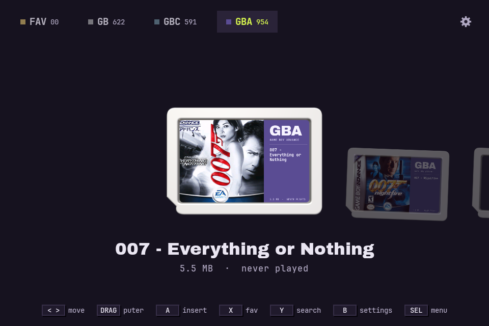
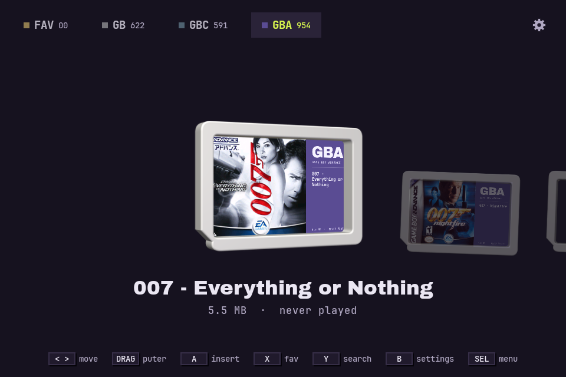
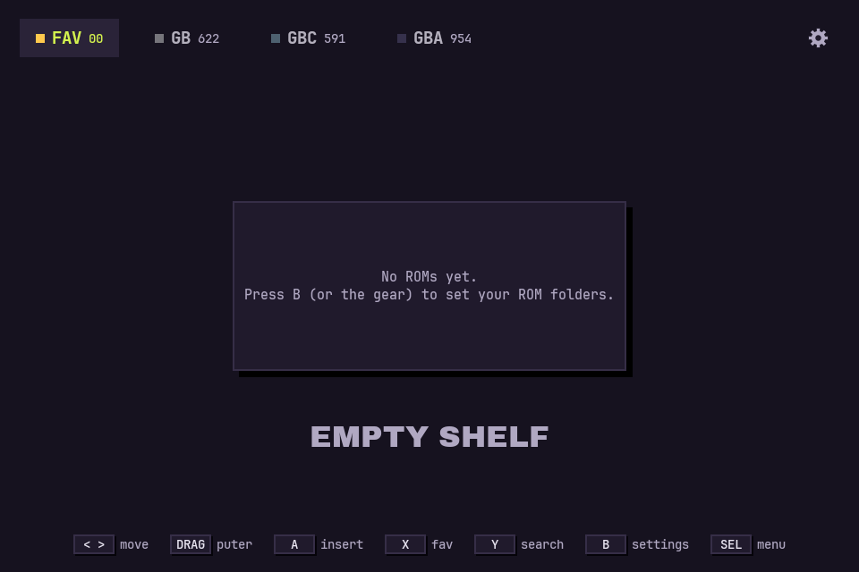
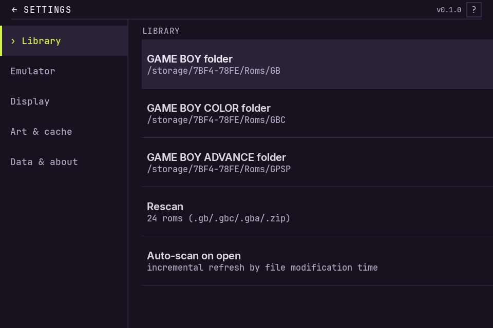
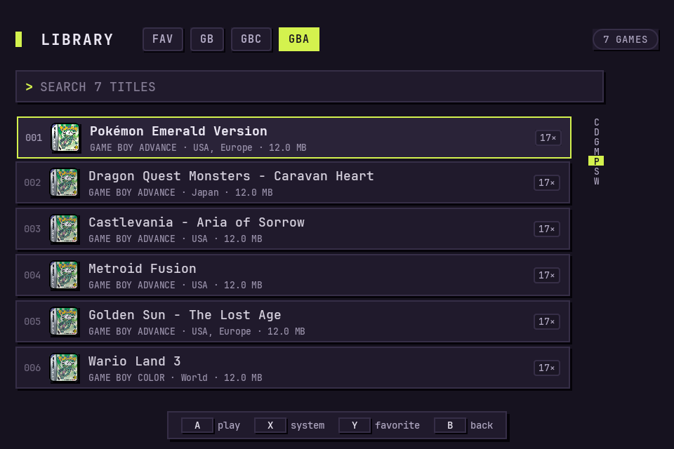

# Kartrid

**A shelf of 3D cartridges for your Game Boy library — not another grid of covers.**

Kartrid scans your GB / GBC / GBA ROM folders, renders every game as a photoreal
Switch-style cartridge standing on a landscape shelf, and launches it in RetroArch
with the core you chose. Drag the focused cartridge to spin it — the shell, the
recessed label and the artwork move together, because they are one 3D-rendered object,
not a flat card.

<p align="center">
  
</p>

It is a **frontend, not an emulator**: no cores, no BIOS, no ROMs, no scraping service.

---

## Highlights

- **Real 3D cartridges.** 27 pre-rendered shell frames (−26°…+26°) with a genuine
  recessed label window. Boxart is perspective-warped into the label at runtime, so it
  stays sharp and stays *yours* (custom art still works).
- **Boxart is never cropped.** The label is a square 1:1 artwork plate plus a coloured
  panel carrying the system code, title and metadata — like a real cartridge label.
- **Per-system identity.** GB → warm grey, GBC → teal, GBA → indigo. Readable from
  across the room, no legend needed.
- **Touch to spin.** Drag horizontally to rotate around the cartridge's centre, release
  and it springs back. Only the focused cartridge moves.
- **D-pad first.** Every action has a button; touch is a bonus, never a requirement.
- **Your folders, your rules.** SAF folder picker per system, auto-scan on launch,
  favourites, search with A–Z rail, "last played" stats, custom boxart per game.
- **Tiny asset budget.** All 27 shell frames together are ~425 KB.

## Screenshots

| Spin the focused cartridge | Favourites (empty state) |
|---|---|
|  |  |

| Settings | Search & list |
|---|---|
|  |  |

## Requirements

| | |
|---|---|
| Android | 8.0+ (`minSdk 26`) |
| Emulator | [RetroArch](https://www.retroarch.com/) with the Gambatte / mGBA cores installed |
| Storage | ROMs on internal or SD storage, reachable through the system folder picker |
| Build | JDK 17, Android SDK 35 |

Tested on the **KONKR Pocket Advance** (960×640 landscape, D-pad + A/B/X/Y), but the
canvas scales proportionally to any screen.

## Build

```bash
git clone git@github.com:iqbaladinur/katrid.git
cd katrid

# JDK 17 + Android SDK 35 must be reachable
export JAVA_HOME="$HOME/android-dev/jdk-17"
export ANDROID_HOME="$HOME/android-dev/sdk"
export PATH="$JAVA_HOME/bin:$ANDROID_HOME/platform-tools:$PATH"

cd android
./gradlew :app:assembleDebug
adb install -r app/build/outputs/apk/debug/app-debug.apk
```

Or use the helper, which builds, installs and launches on the connected device:

```bash
./deploy.sh                      # build + install + start
./deploy.sh connect 192.168.1.7:5555   # wireless debugging first
```

## Controls

| Input | Action |
|---|---|
| D-pad ◀ ▶ | previous / next cartridge |
| L1 / R1 | previous / next tab (FAV · GB · GBC · GBA) |
| **A** | insert cartridge → launch in RetroArch |
| **X** | toggle favourite |
| **Y** | search |
| **B** | settings |
| **SELECT** | cartridge menu (set / remove custom boxart, favourite) |
| Drag on the focused cartridge | spin it; release to snap back to its resting angle (right edge back, at the rotation limit) |

## How it works

```
ROM folders ──► RomScanner ──► Game list ──► ShelfScreen ──► Cartridge compose
                                   │                            │
                     libretro-thumbnails (boxart)          label bitmap (art 1:1 + system panel)
                     or your own image                     │
                                                           ▼
                                           perspective warp (setPolyToPoly) into the
                                           4 label corners of the current 3D frame
```

The shell is modelled procedurally at the real cartridge dimensions
(31.5 × 21.5 × 3.4 mm) and rendered headlessly with three.js — no downloaded model, no
Nintendo asset, licence-clean. Details, measurements and the regeneration pipeline live
in [docs/ARCHITECTURE.md](docs/ARCHITECTURE.md).

## Regenerating the cartridge frames

The 27 PNGs in `android/app/src/main/res/drawable-nodpi/cf_*.png` and the generated
`CartFrames.kt` are build artefacts of the design pipeline:

```bash
python3 -m venv ~/.venvs/mockup && ~/.venvs/mockup/bin/pip install playwright pillow numpy
cd design/cart3d
~/.venvs/mockup/bin/python seq.py        # renders 27 angles, writes PNGs + CartFrames.kt
```

Change the model in `design/cart3d/seq.html` (dimensions, bevel, recess depth, label
inset) and re-run — the Kotlin data file is regenerated with the new label quads, so the
runtime warp can never drift from the render.

## Development

The UI is Compose on a fixed 960×640 design canvas (`MockCanvas`), which is why every
number in the code equals the number in the design file.

Robolectric screenshot tests render the real UI to PNG without a device:

```bash
cd android && ./gradlew :app:testDebugUnitTest
# → ../previews/*.png
```

## Project layout

```
android/                 Android app (Kotlin, Jetpack Compose)
  app/src/main/java/id/iqbaldev/kartrid/
    core/                ROM scanning, settings store, RetroArch intent, art cache
    ui/                  Shelf, list, settings, folder picker, cartridge renderer
    ui/CartFrames.kt     GENERATED — 27 angles × label quads
design/                  Design system work: mockups, 3D render pipeline, art
  cart3d/                three.js scene + scripts that produce the cartridge assets
docs/                    Architecture notes and screenshots
previews/                Robolectric render output
PLAN.md                  Original design brief and decisions
```

## Roadmap

- Animated insertion: cartridge drops into a slot when launched
- Grid / list density options
- Portrait layout for phones
- Optional per-system shell tint

## Contributing

Bug reports, screenshots on other hardware and pull requests are welcome — see
[CONTRIBUTING.md](CONTRIBUTING.md). Please run the screenshot tests before opening a PR.

## Credits

- Boxart is fetched on demand from [libretro-thumbnails](https://github.com/libretro-thumbnails/libretro-thumbnails);
  all artwork remains the property of its respective owners.
- Type: Archivo Black, Inter, JetBrains Mono (SIL Open Font License).
- Rendering: [three.js](https://threejs.org/) (MIT).
- Built for [RetroArch](https://www.retroarch.com/).

## Legal

Kartrid is an unofficial hobby project. It is **not affiliated with, endorsed by or
sponsored by Nintendo**. "Game Boy", "Game Boy Color", "Game Boy Advance", "Nintendo
Switch" and related marks are trademarks of Nintendo. The cartridge shell in this repo is
an original 3D model based on publicly documented physical dimensions — no Nintendo
artwork, firmware or ROM is included.

Kartrid ships **no ROMs, no BIOS files and no emulator cores**. You must own the games
you play. Boxart is downloaded from a public thumbnail repository at your request; disable
it in Settings if you prefer.

## License

[MIT](LICENSE) © 2026 Iqbal Adi Nur
